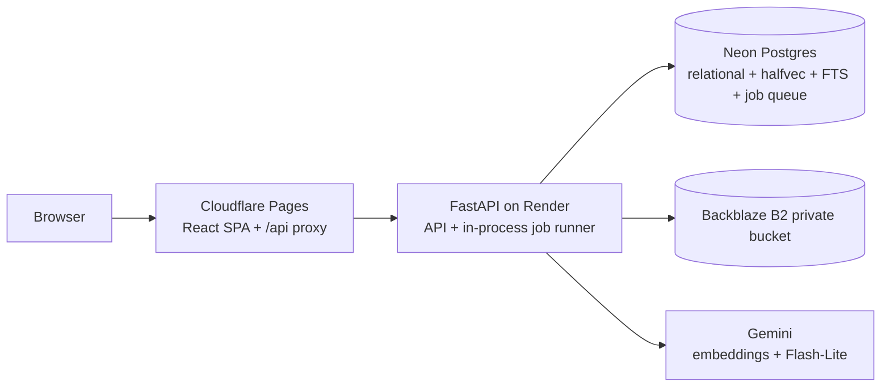

# DocuMind

Ask questions about your documents and get answers that link to the exact passage they came from.

Upload PDFs, Word files and plain text into a shared workspace. DocuMind indexes them, finds the relevant
passages for each question (meaning + keywords), and has Gemini answer **only from those passages**, with
numbered citations that open the source page with the passage highlighted. If the documents don't contain the
answer, it says so instead of guessing.

**Stack:** React 19 + TypeScript + Tailwind/shadcn · FastAPI (Python 3.14) · Postgres 17 + pgvector · Google Gemini ·
Cloudflare Pages · Render · Neon · Backblaze B2 · GitHub Actions. Runs on free tiers.

## What it does

- **Grounded answers** — hybrid retrieval (pgvector cosine + Postgres full-text, fused with Reciprocal Rank Fusion),
  a relevance floor that answers "not found" without calling the model, and citation checking that removes any
  `[S#]` marker the model invents. Answers stream over SSE.
- **Workspaces and roles** — owner / admin / member / viewer, invite links, and tenant isolation enforced in SQL
  (composite foreign keys; other workspaces' data returns 404, never 403).
- **Documents** — validated uploads (magic bytes, zip-bomb and macro checks), page-aware chunking, collections,
  a Postgres job queue (`FOR UPDATE SKIP LOCKED`) with retries.
- **Search, analytics, notifications** — passage search that doesn't spend AI questions, an admin usage dashboard
  (with cost shown as an estimate, not a bill), an activity log and an in-app notification bell.
- **Privacy by default** — nothing is sent to Gemini until a workspace admin allows it; per-user daily question caps;
  conversations are private to their author.
- **Public demo** — a read-only workspace with made-up sample documents that anyone signed in can try; it resets nightly.

## Architecture



The browser only ever talks to the Pages origin, so the HttpOnly auth cookies are first-party; the Pages Function
forwards `/api/*` to Render with a shared secret, and the API refuses requests that skip it. Design decisions and
trade-offs are in [docs/PHASE-1-ARCHITECTURE.md](docs/PHASE-1-ARCHITECTURE.md).

## Run it locally (Windows / PowerShell)

Needs Docker Desktop, [uv](https://docs.astral.sh/uv/) and pnpm. Full details: [backend/README.md](backend/README.md),
[frontend/README.md](frontend/README.md).

```powershell
docker compose up -d db
```
```powershell
cd backend; Copy-Item .env.example .env; uv sync; uv run alembic upgrade head; uv run uvicorn app.main:app --reload
```
```powershell
cd frontend; pnpm install; pnpm dev
```

Open http://localhost:5173. Set `GEMINI_API_KEY` in `backend/.env` for real answers, or `AI_PROVIDER=fake` to work offline.

## Tests and checks

| | Command | What runs |
|---|---|---|
| API | `uv run pytest` | 120 tests against real Postgres + pgvector: auth, isolation, ingestion, RAG, demo, proxy, storage cap |
| API | `uv run ruff check . && uv run mypy app` | Lint and strict types |
| Web | `pnpm test` | 45 Vitest + Testing Library tests with MSW |
| Web | `pnpm lint && pnpm typecheck && pnpm build` | oxlint (with a11y rules), TypeScript 7, production build |

CI runs all of these plus dependency audits (`pip-audit`, `pnpm audit`) and a Docker build on every push.

## Deploy

Step-by-step guide: **[docs/DEPLOY.md](docs/DEPLOY.md)** (Neon → Backblaze B2 → Render → Pages → GitHub Actions, about an hour, $0/month).
