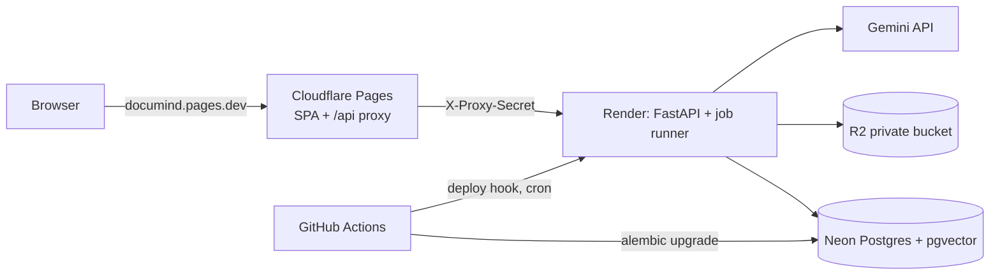

# Deploying DocuMind (free tier)

This guide puts DocuMind online for **$0/month**:

| Piece | Service | Why |
|---|---|---|
| Web app (React) | **Cloudflare Pages** | Free static hosting; a Pages Function proxies `/api/*` so cookies stay first-party |
| API (FastAPI) | **Render** free web service (Docker) | Runs the API and the background indexing |
| Database (Postgres + pgvector) | **Neon** free | Postgres with vector search, 1 GB |
| Uploaded files | **Cloudflare R2** (private bucket) | 10 GB free, no egress fees |
| AI | **Google Gemini** (AI Studio key) | Embeddings + answers |
| Automation | **GitHub Actions** | CI, migrations + deploy, hourly job drain, nightly demo reset |



Plan about **45–60 minutes** the first time. Do the steps in order: later steps paste values from earlier ones.
Keep a private note (e.g. a password manager entry) for the values marked 📋 — never commit them.

---

## 0. Before you start

1. **Push the repo to GitHub.** Render and Cloudflare Pages deploy from a GitHub repository.
2. **Make two random secrets** (run twice, from `backend/`) and save them as 📋 `PROXY_SECRET` and 📋 `INTERNAL_SECRET`:

   ```powershell
   uv run python -c "import secrets; print(secrets.token_urlsafe(48))"
   ```

   - `PROXY_SECRET` — shared by Cloudflare Pages and Render, so the API only accepts traffic from your Pages site.
   - `INTERNAL_SECRET` — shared by Render and GitHub Actions, for the hourly drain and nightly demo reset.

3. **Gemini key.** You can reuse the one in `backend/.env`, or create a separate one at
   [aistudio.google.com](https://aistudio.google.com) → *Get API key* (recommended, so you can revoke it on its own).
   Free tier: Google may use submitted content to improve its products — the public demo only uses the made-up
   sample documents, and the sign-up page warns users not to upload confidential files.

## 1. Neon (database)

1. Sign up at [neon.com](https://neon.com) → **New project**.
   - Postgres version: **17**. Region: **AWS Asia Pacific (Singapore)** — same region as the Render service.
2. On the project dashboard click **Connect**:
   - With **Connection pooling ON**, copy the string → 📋 `NEON_POOLED_URL` (host contains `-pooler`).
   - With **Connection pooling OFF**, copy the string → 📋 `NEON_DIRECT_URL`.

   Paste them exactly as Neon shows them (`postgresql://…?sslmode=require&channel_binding=require`); the app converts
   them. The `vector` and `citext` extensions are created by the first migration.

## 2. Cloudflare R2 (file storage)

1. Sign up at [dash.cloudflare.com](https://dash.cloudflare.com). Open **R2 Object Storage**.
   R2 asks for a payment method before you can use it, even on the free allowance (10 GB, no egress fees).
2. **Create bucket** → name `documind-files`, location *Automatic*. Leave **public access off** (the app only hands out
   short-lived signed download links).
3. Back on the R2 overview → **Manage API tokens** → **Create API token**:
   - Permission: **Object Read & Write**, applied to **only** the `documind-files` bucket.
   - Copy 📋 `S3_ACCESS_KEY_ID`, 📋 `S3_SECRET_ACCESS_KEY` (shown once) and the endpoint
     📋 `S3_ENDPOINT_URL` (`https://<account_id>.r2.cloudflarestorage.com`).

## 3. Render (API)

1. Sign up at [render.com](https://render.com) with GitHub. **New → Blueprint** → pick the repo. Render reads
   [`render.yaml`](../render.yaml) and shows one service, `documind-api` (free, Singapore).
2. Fill the values it asks for:

   | Key | Value |
   |---|---|
   | `DATABASE_URL` | 📋 `NEON_POOLED_URL` |
   | `FRONTEND_URL` | `https://documind.pages.dev` for now (fix in step 4.4 if the name differs) |
   | `PROXY_SHARED_SECRET` | 📋 `PROXY_SECRET` |
   | `INTERNAL_API_SECRET` | 📋 `INTERNAL_SECRET` |
   | `GEMINI_API_KEY` | your Gemini key |
   | `S3_ENDPOINT_URL`, `S3_BUCKET` (`documind-files`), `S3_ACCESS_KEY_ID`, `S3_SECRET_ACCESS_KEY` | from step 2 |

   `JWT_SECRET` is generated by Render. Click **Apply**.
3. The first deploy builds the image (~5 min). It will log *database unmigrated* — expected; step 5 migrates.
4. Copy the service URL → 📋 `API_URL` (e.g. `https://documind-api.onrender.com`, no trailing slash).
5. Service → **Settings → Deploy Hook** → copy 📋 `RENDER_DEPLOY_HOOK_URL` (treat it like a password).

## 4. Cloudflare Pages (web app)

1. Cloudflare dashboard → **Workers & Pages → Create → Pages → Connect to Git** → pick the repo.
2. Build settings:

   | Setting | Value |
   |---|---|
   | Project name | `documind` (becomes `documind.pages.dev`) |
   | Production branch | `main` |
   | Framework preset | None |
   | Root directory | `frontend` |
   | Build command | `pnpm build` |
   | Build output directory | `dist` |

3. **Environment variables (Production)** before the first build:
   - `API_ORIGIN` = 📋 `API_URL`
   - `PROXY_SECRET` = 📋 `PROXY_SECRET` → click **Encrypt**

   Node and pnpm versions come from `frontend/.node-version` and `"packageManager"` in `package.json`.
   If the build log shows an older pnpm, add `PNPM_VERSION` = `12.21.0`.
4. **Save and Deploy.** If the site URL isn't `https://documind.pages.dev`, update `FRONTEND_URL` on Render.

## 5. GitHub Actions (migrations, deploys, schedules)

1. Repo → **Settings → Environments → New environment** → `production`.
2. Add **environment secrets**:

   | Secret | Value |
   |---|---|
   | `NEON_DIRECT_URL` | 📋 `NEON_DIRECT_URL` (direct, not pooled: migrations need it) |
   | `RENDER_DEPLOY_HOOK_URL` | 📋 `RENDER_DEPLOY_HOOK_URL` |
   | `API_URL` | 📋 `API_URL` |
   | `INTERNAL_API_SECRET` | 📋 `INTERNAL_SECRET` |

3. **Actions → Deploy API → Run workflow.** It migrates Neon, triggers Render and waits for `/readyz`.
   From now on every push to `main` does this automatically once CI passes.
4. **Actions → Scheduled jobs → Run workflow → demo-reset** once, to confirm the internal secret matches.

## 6. Check it works

- [ ] `https://documind.pages.dev` loads (first visit after idle can take ~1 minute while Render wakes up).
- [ ] Register, then **Try the demo workspace** → ask *“How many vacation days do employees get?”* → answer with a citation.
- [ ] In your own workspace: allow AI processing, upload a small TXT/PDF, it reaches **Ready**, ask about it.
- [ ] `https://<api>.onrender.com/api/v1/auth/csrf` returns **403** (the API refuses traffic that skips Pages).
- [ ] `https://<api>.onrender.com/api/docs` returns **404** (Swagger is off in production).

## Living on the free tier

- **Sleep:** Render sleeps after 15 idle minutes; the app shows a “waking up” screen. Upgrading the Render instance (~$7/mo) removes it — no code change.
- **Leftover jobs:** uploads queued right before a sleep finish on the next request or the hourly *Scheduled jobs* run.
- **Storage:** Neon free is 1 GB. Vectors are `halfvec(768)` and each workspace is capped (`MAX_CHUNKS_PER_WORKSPACE`).
- **Gemini quota:** if Google returns 429, users see a friendly message and indexing retries later (1, 5, 30 min).
- **Email is off** (`EMAIL_BACKEND=disabled`): no verification or password-reset emails yet. Adding a provider such as Resend needs a domain you own.
- **Demo:** resets nightly at 02:00 Manila time (conversations cleared, sample documents restored).

## Troubleshooting

| Symptom | Likely cause |
|---|---|
| Every API call returns `403 direct_access_denied` from the site | `PROXY_SECRET` (Pages) ≠ `PROXY_SHARED_SECRET` (Render), or Pages wasn't redeployed after setting it |
| `503 proxy_misconfigured` | `API_ORIGIN` not set in Pages |
| Render deploy fails with `PROXY_SHARED_SECRET must be set` / `JWT_SECRET…` | A required production variable is empty |
| `/readyz` says `unreachable_or_unmigrated` | Deploy API workflow hasn't run, or `NEON_DIRECT_URL` is wrong |
| Scheduled job fails with 401 | `INTERNAL_API_SECRET` differs between GitHub and Render |
| Uploads fail | R2 token not scoped to the bucket, wrong endpoint, or `S3_BUCKET` misspelled |

## Rehearsing locally

The production image and the Pages proxy can run on your machine (this is how Phase 7 was verified):

```powershell
docker compose --profile api up -d --build api   # set ENV=production etc. via an override file
pnpm --dir frontend build
pnpm --dir frontend preview:pages                # http://localhost:8788 -> proxy -> localhost:8000
```

`preview:pages` passes `PROXY_SECRET=local-proxy-secret`, so the API container needs
`PROXY_SHARED_SECRET=local-proxy-secret`.
