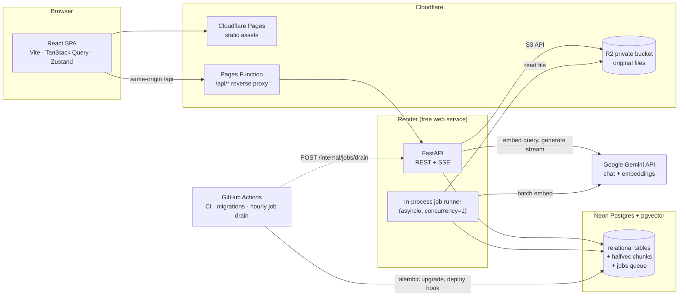

# DocuMind — Phase 1: Architecture & Planning

> *Your documents. Your knowledge. Powered by AI.*
> Status: **Approved 2026-11-23**: all eight recommended defaults in §J accepted (Pages Function proxy, console email backend for the MVP, `gemini-embedding-001`@768 `halfvec`, Flash-Lite default, consent gate, RLS deferred to Phase 6, uv + pnpm, monorepo).

Free-tier facts in this document were checked on 2026-11-23 (sources are listed in §G). Providers change quotas often, so every limit is an env variable and gets re-checked before deploy.

---

## A. Project Overview

### Product vision
DocuMind is a multi-tenant AI document workspace. Teams upload PDFs, DOCX and TXT files, organize them into collections, and ask questions in plain language. Answers are **grounded**: each claim links to the exact chunk, page and passage it came from, and the assistant says so when the documents don't contain the answer.

### Target users
Students and researchers, professionals and freelancers, small businesses, and teams with internal knowledge (handbooks, policies, contracts).

### Problems solved
| Problem | DocuMind answer |
|---|---|
| Reading hundreds of pages to find one clause | Semantic search and Q&A over every document |
| AI answers you can't trust | Citations checked server-side against the chunks that were actually retrieved, with a click-through passage preview |
| Knowledge scattered across files | Collections plus questions asked across a whole collection |
| Shared team knowledge leaking between groups | Isolated workspaces with roles |

### Differentiation (portfolio angle)
1. **Citation integrity as a feature.** The backend rejects citation markers that don't map to a retrieved chunk. The UI shows "verified source" excerpts, not model-written quotes.
2. **Hybrid retrieval.** pgvector similarity plus Postgres full-text search, fused with Reciprocal Rank Fusion. It works better than vector-only search on names, numbers and clause IDs.
3. **Tenant isolation you can test.** A dedicated test suite tries to read across workspaces through every endpoint and through vector search.
4. **Free-first operations.** Quota-aware AI calls, a usage ledger, graceful degradation, and documented limits.

---

## B. MVP Scope

### MVP (Phases 2–5, plus the minimal part of 6–7)
- **Auth:** register, login, logout, refresh rotation, `/me`, forgot and reset password, protected routes.
- **Workspaces:** a personal workspace is created automatically; create, rename, switch, invite by link, roles, remove member.
- **Documents:** multi-file drag-and-drop upload (PDF, DOCX, TXT ≤ 10 MB), list and grid, title search, type filter, sort, rename, delete, status lifecycle, error messages, text preview by page.
- **Collections:** CRUD, many-to-many with documents, filter by collection, ask a collection.
- **Processing:** a Postgres-backed job queue, extract → normalize → chunk (page-aware) → embed → store, idempotent with retries.
- **RAG chat:** conversations (create, rename, delete), scope (workspace, collection or selected docs), streamed answers, verified citations, open-source passage panel, copy, regenerate, suggested follow-ups.
- **AI presets:** Q&A, Summarize, Key points. These are prompt templates over the same pipeline.
- **Usage:** per-request ledger (tokens, model, latency, status), daily question cap, compact usage card, and a basic Owner/Admin analytics page.
- **Notifications:** in-app (processing done or failed, invitation, limit reached), polled.
- **Activity log:** uploads, deletes, membership changes, renames.
- **Settings:** profile, password, theme, workspace details and members, AI consent acknowledgement.
- **Demo:** a seeded read-only demo workspace with public-domain or sample documents.

### Postponed (Phase 6+ / future)
Document comparison, structured extraction, study notes, action items, inconsistency detection; OCR for scanned PDFs (MVP marks them *Failed: no extractable text*); email notifications; PDF canvas rendering with highlight overlays (MVP uses a page-text preview); Postgres Row-Level Security as defense in depth; billing and subscriptions; SSO; real-time push over WebSockets; retention auto-purge jobs.

### Acceptance criteria (MVP "done")
1. A new user registers, gets a personal workspace, uploads a 40-page PDF, and sees it reach **Ready** within about 2 minutes on the deployed stack while warm.
2. A question answered from that PDF returns a streamed answer with ≥ 1 citation. Each citation opens the correct document, page and excerpt.
3. A question the documents can't answer gets an explicit "not found in your documents" reply with **zero** citations.
4. A document containing "ignore previous instructions…" does not change system behavior (eval test passes).
5. User B gets **404** on every endpoint for workspace A's resources. Vector search never returns another workspace's chunks (test suite passes).
6. Deleting a document removes its chunks immediately. Past citations show "source deleted" and keep their stored excerpt.
7. When Gemini returns 429 or quota exhaustion, the user sees a clear "AI temporarily unavailable" state. The app keeps working and the event is recorded.
8. No tokens are kept in localStorage. Cookies are HttpOnly, Secure and SameSite. Mutating requests require a CSRF token.
9. CI is green: backend tests, frontend tests, typecheck, lint, and build.

---

## C. System Architecture

### Overview diagram


### Frontend architecture
- **React 19 + TypeScript + Vite**, **Tailwind CSS v4**, **shadcn/ui** (Radix primitives, so components are accessible by default), **lucide-react**, **React Router** (data router).
- **Server state:** TanStack Query. **Client state:** Zustand, limited to the active workspace id, theme, command palette, and panel layout. Server data is never copied into Zustand.
- **Forms:** React Hook Form with Zod. The Zod schemas are hand-written to mirror the backend Pydantic schemas. OpenAPI type generation (`openapi-typescript`) gives typed API responses.
- **API client:** Axios instance with `withCredentials`, an interceptor that attaches the CSRF header, and a 401 → refresh → retry-once flow. Streaming uses `fetch` with a `ReadableStream` SSE parser, because Axios can't stream in browsers.
- **Feature folders:** `features/{auth,dashboard,documents,collections,ai-workspace,search,analytics,settings}`. Each holds `api.ts` (query hooks), `components/`, `routes/` and `schemas.ts`.
- **Live updates:** polling. Document status polls every 3 s only while some document is non-terminal. Notifications poll every 30 s. No WebSockets, which keeps free hosting simple.

### Backend architecture
```
backend/app/
  main.py            app factory, middleware, exception handlers, lifespan (starts job runner)
  core/              config (pydantic-settings), security (hashing, JWT, CSRF), logging (structlog), errors
  api/v1/            routers: thin; parse → call service → map to schema
  api/deps.py        get_db, get_current_user, require_workspace(role=...)  ← authorization choke point
  models/            SQLAlchemy 2 ORM (typed Mapped[])
  schemas/           Pydantic v2 request/response DTOs
  services/          business rules + transactions (DocumentService, ChatService, ...)
  repositories/      query functions that ALWAYS take workspace_id (no unscoped getters)
  integrations/      gemini.py (AIProvider protocol impl), storage.py (R2/S3 + local FS for dev)
  rag/               parsing/, chunking.py, embedding.py, retrieval.py (hybrid + RRF), prompts.py, citations.py
  workers/           job queue (claim/lease/retry), handlers (index_document, purge_document)
  utils/
```
- **Async stack:** FastAPI + SQLAlchemy 2 async + `asyncpg`. Parsing is CPU-bound and runs in `asyncio.to_thread` so it doesn't block the event loop.
- **Provider abstraction:** a small `AIProvider` protocol (`embed(texts) / generate_stream(...)`) with `GeminiProvider` and a `FakeProvider` for tests. Model names and dimensions come from env.
- **Conventions:** plain resource JSON on success, and an RFC 9457 `application/problem+json` error envelope (`type, title, status, detail, code`) from one exception handler. Cursor pagination for lists.
- **Tooling:** Python 3.12, `uv` for dependency management, `ruff` (lint + format), `mypy` (strict on `core/`, `rag/` and `services/`), `pytest` + `pytest-asyncio`.
- **Why not a heavier pattern** (CQRS, unit-of-work classes, DI containers): FastAPI `Depends` already provides injection, and repositories stay as plain functions. That's enough structure for this size of project.

### AI / RAG architecture

**Indexing**
1. **Extract:** PyMuPDF yields text per page. python-docx yields paragraphs and tables; DOCX has no reliable pages, so "sections" are synthesized from headings or every ~3 000 characters. TXT is decoded with charset detection (`charset-normalizer`) and has no pages.
2. **Normalize:** Unicode NFKC, de-hyphenate line breaks, collapse whitespace, strip NUL and control characters, and remove repeated headers and footers when the same line appears on ≥ 60 % of pages.
3. **Chunk:** a recursive splitter (paragraph → sentence → word), targeting **~800 tokens with ~120 overlap** (configurable). Chunks **never cross page boundaries**, so every chunk has exactly one `page_number`. Each chunk stores `char_start/char_end` within its page so the preview can highlight it.
4. **Embed:** Gemini embeddings, **`gemini-embedding-001` at `output_dimensionality=768`** with `task_type=RETRIEVAL_DOCUMENT` (queries use `RETRIEVAL_QUERY`). Requests are batched and throttled to stay under RPM and TPM. Vectors are L2-normalized because truncated outputs aren't pre-normalized.
5. **Store:** `document_chunks.embedding halfvec(768)`, with an HNSW index on cosine distance, a `tsvector` column with a GIN index for full-text search, and the denormalized `workspace_id` for filtering.

**Querying**
1. Authorize the workspace, then resolve the scope (all docs, collection, or selected doc ids) **server-side** into a set of Ready document ids the user can access.
2. Rewrite follow-ups into a standalone query using the last few turns. This is one cheap model call and can be disabled through config.
3. Embed the query, run **vector top-k (20)** and **full-text top-k (20)**, both `WHERE workspace_id = :ws AND document_id = ANY(:docs)`, then fuse with RRF and keep the **top 6–8** within a token budget.
4. Build the prompt with system rules plus sources labelled `[S1]…[Sn]`, each with doc name and page, wrapped in `<source id="S1">…</source>` delimiters.
5. Stream through SSE with events `token`, `citations`, `usage`, `done` and `error`.
6. **Citation verification:** parse `[S#]` markers from the final text and keep only those that map to the retrieved set. Persist `message_citations` (chunk id, doc id, page, excerpt snapshot). Invalid markers are stripped and counted as an eval metric.
7. Write an `ai_usage_records` row with provider-reported `usage_metadata` tokens, model, latency and status.

**Grounding and injection defenses**
- The system prompt states that sources are *untrusted data* and that instructions inside them must be ignored. The model answers only from the sources, cites every factual claim, and says "I couldn't find this in the selected documents" when evidence is missing. Facts from sources are kept separate from interpretation (for example, *"Based on [S2], this suggests…"*).
- **The model has no tools or actions**, so a successful injection can at worst change the text of an answer. It can't read other tenants' data, because retrieval is filtered before the model sees anything.
- **Relevance floor:** if the best fused result is below a similarity threshold, the app skips generation and returns the "not found" answer. This saves quota and prevents hallucination.

### Database architecture
A single Neon Postgres holds relational data, vectors and the job queue. That removes Redis, Pinecone and SQS: one system to back up, migrate and reason about. pgvector supports transactional deletes, so removing a document removes its vectors atomically.

### File storage architecture
- Private **R2 bucket**, accessed through the S3-compatible API (`boto3`). Keys are `ws/{workspace_id}/docs/{document_id}/{uuid4}` and **never contain user filenames** (no path traversal, no PII in keys).
- Uploads go through the API (multipart, streamed, 10 MB cap). The API checks magic bytes (`%PDF-`, ZIP + `word/document.xml` for DOCX, UTF-8/16 decodability for TXT) and rejects encrypted PDFs, DOCX with macros (`.docm` content types) and zip bombs (uncompressed-size ratio check). Only then does it write to R2.
- Downloads use an authorized endpoint that returns a **60-second presigned GET URL** after checking the workspace role. The browser never sees bucket credentials.
- In local dev, `STORAGE_BACKEND=local` writes to a Docker volume. In compose, MinIO is optional for S3 parity.

### Background processing architecture
**Problem:** Render's free tier has no always-on background workers, and web services sleep after 15 minutes without traffic and lose their filesystem.

**Design: a Postgres job queue drained by an in-process runner.**
- The `processing_jobs` table works as a queue. Workers claim jobs with `SELECT … FOR UPDATE SKIP LOCKED`, set `locked_until = now() + 5 min` (the lease), and increment `attempts`.
- The FastAPI lifespan starts one asyncio runner loop (**concurrency 1**, set by config) that drains the queue. An upload enqueues a job and nudges the runner through an in-memory event.
- **Sleep safety:** while a job runs, the service is still handling HTTP (the frontend polls status), so it rarely sleeps mid-job. If it does, the lease expires and the job is reclaimed on the next boot or drain. Jobs are **idempotent**: indexing deletes the document's existing chunks and reinserts them in one transaction, keyed by `(document_id, content_hash)`.
- **Retries:** exponential backoff (1 min, 5 min, 30 min). Quota errors (429) reschedule without consuming an attempt. After `max_attempts=3`, the document is marked **Failed** with a user-facing reason.
- **Safety net:** a GitHub Actions cron runs every hour and calls `POST /internal/jobs/drain` with a shared secret. This finishes any queued work after a sleep. It runs hourly, not as a 14-minute keep-alive, so it stays within Render's fair use.
- **Why not Celery, RQ or Redis:** they need a second always-on process plus a broker, which costs money or doesn't fit free tiers. The DB queue is transactional with the document row, so a document can never be "uploaded" without a job.
- **Upgrade path:** move the runner into a separate Render Background Worker (paid) with no code change, because the runner is already isolated behind a CLI entry point (`python -m app.workers.run`).

### Deployment architecture
| Concern | Choice |
|---|---|
| Frontend | Cloudflare Pages (Git integration) |
| API origin | Render free web service from a Docker image |
| Same-origin cookies | **Pages Function proxies `/api/*` to Render**, so the browser only ever talks to `documind.pages.dev`. This avoids third-party-cookie blocking (Safari/ITP, Chrome) that would break HttpOnly auth across `pages.dev` ↔ `onrender.com`. SSE passes through as a stream. |
| DB | Neon Free (pooled connection string for the app, direct string for Alembic) |
| Migrations | GitHub Actions runs `alembic upgrade head` against Neon, then calls the Render deploy hook |
| Secrets | Render env vars, Cloudflare env vars and GitHub Actions secrets only. `.env.example` is committed and holds no values |
| Health | `GET /healthz` (liveness, no DB) and `GET /readyz` (DB plus migration version) |

---

## D. Database Design

### ERD
```mermaid
erDiagram
  users ||--o{ workspace_members : "belongs to"
  users ||--o{ refresh_tokens : has
  users ||--o{ auth_tokens : has
  workspaces ||--o{ workspace_members : has
  workspaces ||--o{ workspace_invitations : has
  workspaces ||--o{ documents : contains
  workspaces ||--o{ collections : contains
  workspaces ||--o{ conversations : contains
  workspaces ||--o{ processing_jobs : queues
  workspaces ||--o{ ai_usage_records : meters
  workspaces ||--o{ activity_logs : records
  users ||--o{ notifications : receives
  documents ||--o{ document_pages : has
  documents ||--o{ document_chunks : has
  documents ||--o{ collection_documents : "in"
  collections ||--o{ collection_documents : groups
  conversations ||--o{ messages : has
  messages ||--o{ message_citations : cites
  document_chunks |o--o{ message_citations : "referenced by"

  users { uuid id PK; citext email UK; text password_hash; text display_name; timestamptz email_verified_at; text theme; timestamptz created_at }
  workspaces { uuid id PK; text name; text slug UK; uuid owner_id FK; bool is_demo; jsonb settings; timestamptz ai_consent_at; timestamptz created_at }
  workspace_members { uuid workspace_id PK,FK; uuid user_id PK,FK; text role; timestamptz joined_at }
  workspace_invitations { uuid id PK; uuid workspace_id FK; citext email; text role; text token_hash UK; timestamptz expires_at; timestamptz accepted_at }
  refresh_tokens { uuid id PK; uuid user_id FK; uuid family_id; text token_hash UK; timestamptz expires_at; timestamptz revoked_at; uuid replaced_by }
  auth_tokens { uuid id PK; uuid user_id FK; text purpose; text token_hash UK; timestamptz expires_at; timestamptz used_at }
  documents { uuid id PK; uuid workspace_id FK; uuid uploaded_by FK; text title; text original_filename; text mime_type; bigint size_bytes; text storage_key UK; text sha256; text status; text error_code; text error_message; int page_count; int chunk_count; text embedding_model; timestamptz deleted_at; timestamptz created_at }
  document_pages { uuid document_id PK,FK; int page_number PK; text text }
  document_chunks { uuid id PK; uuid workspace_id FK; uuid document_id FK; int chunk_index; int page_number; int char_start; int char_end; text content; int token_count; halfvec embedding; text embedding_model; tsvector tsv }
  collections { uuid id PK; uuid workspace_id FK; text name; text description; uuid created_by FK }
  collection_documents { uuid collection_id PK,FK; uuid document_id PK,FK; uuid workspace_id FK }
  conversations { uuid id PK; uuid workspace_id FK; uuid user_id FK; text title; jsonb scope; timestamptz updated_at }
  messages { uuid id PK; uuid conversation_id FK; text role; text content; text status; uuid regenerated_from; timestamptz created_at }
  message_citations { uuid id PK; uuid message_id FK; text marker; uuid chunk_id FK; uuid document_id FK; text document_title; int page_number; text excerpt; float score }
  processing_jobs { uuid id PK; uuid workspace_id FK; uuid document_id FK; text kind; text status; int attempts; int max_attempts; timestamptz run_after; timestamptz locked_until; text last_error }
  ai_usage_records { uuid id PK; uuid workspace_id FK; uuid user_id FK; text operation; text model; int input_tokens; int output_tokens; numeric est_cost_usd; text status; int latency_ms; timestamptz created_at }
  notifications { uuid id PK; uuid user_id FK; uuid workspace_id FK; text type; jsonb payload; timestamptz read_at }
  activity_logs { uuid id PK; uuid workspace_id FK; uuid actor_id FK; text action; text target_type; uuid target_id; jsonb meta; timestamptz created_at }
```

### Key constraints and indexes
| Table | Constraint / index | Why |
|---|---|---|
| all ids | UUIDv7 (`uuid6` lib, generated in the app) | Time-ordered, so B-tree inserts stay compact and ids don't leak counts |
| `users.email` | `citext UNIQUE` | Case-insensitive login |
| `workspace_members` | PK `(workspace_id, user_id)`, `CHECK role IN ('owner','admin','member','viewer')`, partial unique on `(workspace_id) WHERE role='owner'` | Exactly one owner per workspace |
| `documents` | `UNIQUE (workspace_id, id)`, index `(workspace_id, status, created_at DESC)`, partial index `WHERE deleted_at IS NULL`, `UNIQUE (workspace_id, sha256) WHERE deleted_at IS NULL` | Composite-FK target, list queries, duplicate-upload detection |
| `collection_documents` | **Composite FKs** `(workspace_id, collection_id) → collections(workspace_id, id)` and `(workspace_id, document_id) → documents(workspace_id, id)` | The database itself makes cross-workspace links impossible |
| `document_chunks` | `UNIQUE (document_id, chunk_index)`; **HNSW** `(embedding halfvec_cosine_ops)` with `m=16, ef_construction=64`; GIN on `tsv`; btree `(workspace_id, document_id)` | Idempotent reindex, ANN search, keyword search, filtering |
| `processing_jobs` | partial index `(run_after) WHERE status IN ('queued','retry')`; partial unique `(document_id, kind) WHERE status IN ('queued','running','retry')` | Fast claiming, no duplicate indexing |
| `refresh_tokens` | index `(family_id)` | Revoke a whole family on reuse |
| `ai_usage_records` | `(workspace_id, created_at)`, `(user_id, created_at)` | Daily caps and analytics |
| `messages` | `(conversation_id, created_at)` | Chat history |

### Cascades and deletion strategy
| Entity | Strategy |
|---|---|
| Workspace | Hard delete, Owner only, typed confirmation. `ON DELETE CASCADE` to everything, then a purge job removes the R2 prefix |
| Document | **Two-step:** (1) one transaction sets `deleted_at` and status, **hard-deletes chunks and pages**, removes collection links, and enqueues a `purge_document` job; (2) the job deletes the R2 object, then the document row. Retrieval can't see a deleted doc from step 1 onward |
| Citations | `chunk_id` and `document_id` use `ON DELETE SET NULL`. The `excerpt` and `document_title` snapshot is kept, so old answers still read correctly and show "source deleted" |
| Conversation | Hard delete, cascading to messages and citations |
| User | MVP: account deletion requires transferring or deleting owned workspaces first. Memberships cascade |
| Usage and activity | Append-only. `workspace_id` cascades on workspace delete; `user_id` is set to null on user delete |

### Embeddings: dimensions, types, metrics, migration
- **Model and dimension:** `gemini-embedding-001` defaults to 3072 dimensions, and Google recommends truncating to 1536 or 768 (Matryoshka-trained). **I recommend 768.** Retrieval quality barely drops, and 3072 can't be HNSW-indexed: pgvector indexes `vector` up to 2000 dims and `halfvec` up to 4000.
- **Type:** `halfvec(768)` (16-bit floats). Each vector takes about 1.5 KB instead of 3 KB with negligible recall loss. **This is what keeps us inside Neon's 1 GB free storage.**
- **Metric:** cosine distance (`<=>`) with `halfvec_cosine_ops`. Vectors are normalized, so this ranks the same as inner product.
- **Filtered ANN:** HNSW plus a `WHERE workspace_id/document_id` filter can return too few rows. We'll enable `SET hnsw.iterative_scan = relaxed_order` (pgvector ≥ 0.8, which Neon supports; verified at setup). For very small scopes (≤ 2 000 chunks) we skip the index and do an exact scan, which is faster and gives perfect recall.
- **Model migration:** each chunk stores `embedding_model` (for example `gemini-embedding-001@768`). Embeddings from different models are **never** compared. Migration plan: add a nullable column `embedding_v2 halfvec(N)`, backfill with a re-embed job per document, build its index, switch the config flag `EMBEDDING_ACTIVE=v2`, then drop the old column. Queries always use the same model and column as the active index.

### Tenant isolation strategy (layered)
1. **Authorization choke point:** every workspace route uses `require_workspace(min_role)`. It loads the membership from `(workspace_id from path, user from cookie)`. If the user isn't a member, it returns **404, not 403**, so resource existence isn't revealed.
2. **Scoped repositories:** repository functions take a required `workspace_id` argument, and there is no `get_document(id)` without it. A unit test introspects repositories and fails if any query on a tenant table omits `workspace_id`.
3. **DB guarantees:** composite FKs prevent cross-tenant links, and chunks carry `workspace_id` so the vector query is filtered *inside* SQL, before ranking.
4. **Request scope from the server:** the frontend sends doc and collection ids, and the backend intersects them with the workspace's Ready documents before retrieval.
5. **Phase 6 option:** Postgres RLS policies keyed on `SET LOCAL app.workspace_id`, as defense in depth.

---

## E. API Design

Base path `/api/v1`. Auth means a valid access cookie. 🔒M = workspace member with at least the stated role (V=viewer, Mb=member, A=admin, O=owner). Mutating requests require the CSRF header. Errors use `problem+json`: 400/422 validation, 401 unauthenticated, 403 role too low (only within a workspace you belong to), 404 not found or not yours, 409 conflict, 413 too large, 415 unsupported type, 429 rate or quota limit, 503 AI provider unavailable.

### Role permissions
| Capability | Owner | Admin | Member | Viewer |
|---|:-:|:-:|:-:|:-:|
| View docs, collections; chat; search | ✅ | ✅ | ✅ | ✅ |
| Upload, rename own docs, manage collections | ✅ | ✅ | ✅ | ❌ |
| Rename or delete **any** doc | ✅ | ✅ | ❌ (own only) | ❌ |
| Invite and remove members, change roles (≤ Admin) | ✅ | ✅ (not Admin↔Owner) | ❌ | ❌ |
| Usage analytics, AI settings, limits | ✅ | ✅ | ❌ | ❌ |
| Rename workspace, retention settings | ✅ | ✅ | ❌ | ❌ |
| Delete workspace, transfer ownership | ✅ | ❌ | ❌ | ❌ |

Conversations are **private to their creator** in the MVP, so members don't see each other's chats. Sharing conversations is a later feature.

### Endpoint inventory
| Module | Method & path | Purpose | Access |
|---|---|---|---|
| **Auth** | `POST /auth/register` | Create user and personal workspace | Public, rate-limited |
| | `POST /auth/login` | Set access, refresh and CSRF cookies | Public, 5/min/IP + per email |
| | `POST /auth/refresh` | Rotate the refresh token | Refresh cookie |
| | `POST /auth/logout` | Revoke the token family and clear cookies | Auth |
| | `POST /auth/forgot-password` / `POST /auth/reset-password` | Reset flow (always returns 202) | Public, rate-limited |
| | `POST /auth/verify-email` / `POST /auth/resend-verification` | Email verification | Public / Auth |
| | `GET /auth/csrf` | Issue a CSRF cookie | Public |
| **Users** | `GET/PATCH /users/me` · `POST /users/me/password` | Profile and theme, change password | Auth |
| **Workspaces** | `GET/POST /workspaces` | List mine, create | Auth |
| | `GET/PATCH/DELETE /workspaces/{ws}` | Detail, rename and settings, delete | V / A / O |
| | `POST /workspaces/{ws}/ai-consent` | Acknowledge third-party AI processing | A |
| **Members** | `GET /workspaces/{ws}/members` | List | V |
| | `PATCH/DELETE /workspaces/{ws}/members/{user}` | Change role, remove (or leave = self) | A (self: any) |
| | `POST /workspaces/{ws}/invitations` · `GET` · `DELETE /{id}` | Invite link (and email later) | A |
| | `POST /invitations/{token}/accept` | Join | Auth |
| **Documents** | `POST /workspaces/{ws}/documents` (multipart, multi-file) | Upload and enqueue | Mb |
| | `GET /workspaces/{ws}/documents?q=&type=&collection=&status=&sort=&cursor=` | List and search titles | V |
| | `GET/PATCH/DELETE /workspaces/{ws}/documents/{id}` | Detail, rename, delete | V / Mb(own)·A / Mb(own)·A |
| | `GET /workspaces/{ws}/documents/{id}/pages/{n}` | Page text for preview | V |
| | `GET /workspaces/{ws}/documents/{id}/download` | 60 s presigned URL | V |
| | `POST /workspaces/{ws}/documents/{id}/reprocess` | Retry a failed doc | Mb |
| | `GET /workspaces/{ws}/documents/status?ids=` | Batch status poll | V |
| **Collections** | `GET/POST /workspaces/{ws}/collections` · `PATCH/DELETE /{id}` | CRUD | V / Mb |
| | `PUT/DELETE /workspaces/{ws}/collections/{id}/documents` | Add or remove docs (bulk) | Mb |
| **Conversations** | `GET/POST /workspaces/{ws}/conversations` · `PATCH/DELETE /{id}` | List, create (with scope), rename, delete | V (own) |
| **Messages** | `GET /workspaces/{ws}/conversations/{id}/messages` | History with citations | V (own) |
| | `POST /workspaces/{ws}/conversations/{id}/messages` → **SSE** | Ask; streams `token`, `citations`, `usage`, `suggestions`, `done`, `error` | V (own), daily cap |
| | `POST …/messages/{mid}/regenerate` → **SSE** | Regenerate an answer | V (own), daily cap |
| **Search** | `POST /workspaces/{ws}/search/semantic` | Hybrid chunk search, no LLM call | V, rate-limited |
| **Usage** | `GET /workspaces/{ws}/usage/summary` | Compact card (questions today versus cap, storage) | V |
| | `GET /workspaces/{ws}/usage/analytics?from=&to=` | Time series, tokens, est. cost, errors, doc stats | A |
| **Notifications** | `GET /notifications?unread=` · `POST /notifications/read` | List, mark read | Auth |
| **Activity** | `GET /workspaces/{ws}/activity` | Workspace activity feed | A |
| **Settings** | `GET/PATCH /workspaces/{ws}/settings/ai` | Model *label*, preset defaults, per-member daily cap (no secrets) | A |
| **System** | `GET /healthz` · `GET /readyz` · `POST /internal/jobs/drain` | Health, cron drain | Public / Public / shared secret |

FastAPI generates OpenAPI at `/api/docs`. In production it is disabled or behind a flag.

### Auth and session details
- **Passwords:** Argon2id via `pwdlib[argon2]`, with a minimum length of 10 characters and a check against a short list of common passwords.
- **Access token:** a JWT (HS256, 15 min, claims `sub`, `sid`, `exp`, `iat`) in the cookie `dm_access`, which is HttpOnly, Secure, `SameSite=Lax`, `Path=/api`.
- **Refresh token:** a random 256-bit opaque token (30 days) in `dm_refresh` (`Path=/api/v1/auth`), stored **hashed**. It rotates on every use. If an already-rotated token is reused, the whole family is revoked (theft detection), and logout revokes the family too.
- **CSRF:** double-submit token. A readable `dm_csrf` cookie is mirrored in the `X-CSRF-Token` header and checked on every non-GET request. `SameSite=Lax` plus the same-origin proxy is the first line of defense.
- **Rate limits:** `slowapi` in-memory for request rates (fine with a single instance), and DB-backed counters for daily AI caps, which survive restarts.
- **Logging:** structlog JSON with a request id. Cookies, Authorization headers, passwords, tokens and document content are never logged.

---

## F. UI/UX Plan

The design follows the mockup you supplied (purple AI-native workspace, top navigation, bento dashboard). The direction below formalizes it into a system.

### Design direction: "Calm intelligence"
Soft lavender light surfaces, one confident violet accent, generous whitespace, and glass-tinted cards with 1 px hairline borders and soft long shadows. AI moments get a subtle violet-to-indigo gradient shimmer (streaming caret, "Ask" button, citation chips). Everything else stays neutral, so the AI parts read as special.

### Color palette (tokens as CSS variables, shadcn-compatible)
| Token | Light | Dark | Use |
|---|---|---|---|
| `--primary` | `#7C3AED` | `#8B5CF6` | Actions, focus, AI accents |
| `--primary-strong` | `#5B21B6` | `#A78BFA` | Hover, active nav |
| `--accent` | `#A78BFA` | `#6D28D9` | Gradients, chips |
| `--background` | `#F8FAFC` (lavender-tinted `#F7F6FD`) | `#0B0A12` | Page |
| `--surface` | `#FFFFFF` | `#14121F` | Cards |
| `--border` | `#E9E6F5` | `#262236` | Hairlines |
| `--foreground` | `#151325` | `#ECEAF5` | Text |
| `--muted-foreground` | `#6B6880` | `#9A97AE` | Secondary text |
| `--success` | `#10B881` | `#34D399` | Indexed, Ready |
| `--warning` | `#F59E0B` | `#FBBF24` | Processing, quota near |
| `--destructive` | `#EF4444` | `#F87171` | Failed, delete |
| `--ai-gradient` | `135deg #7C3AED → #6366F1` | same, at 90 % | AI affordances only |

File-type hues: PDF red, DOCX blue, TXT slate. All text pairs are checked for WCAG AA (≥ 4.5:1).

### Typography
- **Plus Jakarta Sans** for headings and UI (700 / 600) and **Inter** for body (400 / 500), both from Google Fonts with `font-display: swap`. **JetBrains Mono** for token counts and ids.
- Scale (rem): 0.75 · 0.875 · 1 · 1.125 · 1.5 · 2 · 2.75 (hero). Line-height is 1.5 for body and 1.15 for display. Display headings use −0.02 em tracking.

### Navigation architecture
- **Top bar:** logo · workspace switcher (popover with search and "Create workspace") · primary nav (Home, Documents, Collections, AI Workspace; Analytics only for Admin+) · ⌘K command palette · notifications bell · avatar menu (profile, theme, sign out).
- **Command palette (⌘K, built on `cmdk`):** jump to any document, collection or conversation, run actions ("Upload", "New chat", "Switch workspace"), or type a question and press ↵ to ask AI.
- **Contextual sidebars only where they earn it:** the chat history rail in the AI Workspace (collapsible) and the filter panel on Documents at ≥ lg (a sheet on mobile).
- **Mobile:** the top bar collapses to logo, workspace and avatar, with a **bottom tab bar** (Home, Docs, Ask, Collections, More).

### Component hierarchy (abridged)
```
AppShell
 ├─ TopNav [WorkspaceSwitcher, NavLinks, CommandPalette, NotificationBell, UserMenu]
 ├─ <Outlet/>  (route pages)
 ├─ MobileTabBar
 └─ Toaster
Dashboard: GreetingHero(AskBar) · StatTiles · RecentDocuments · Collections · QuickActions · ProcessingQueue · UsageCard
AIWorkspace: ChatRail(ConversationList) · ChatThread(MessageBubble, StreamingMessage, CitationChip, FollowUps) · ScopePicker · Composer · SourcePanel(PagePreview, HighlightedExcerpt)
Documents: Toolbar(Search, TypeFilter, CollectionFilter, Sort, ViewToggle) · UploadDropzone · DocumentGrid|DocumentTable · DocumentCard(StatusBadge, Menu) · DocumentDrawer
Shared: EmptyState · Skeletons · ErrorBoundary · ConfirmDialog · StatusBadge · FileIcon
```

### Page wireframes
**Dashboard (bento, 12-column grid, ≥ lg)**
```
┌──────────────────────────────────────────────┬──────────────────────┐
│ Good morning, Jan ✨                         │ Processing queue     │
│ [ Ask your documents… (scope ▾)     ⏎ Ask ] │ • Policy.pdf  ▓▓▓░  │
│ chips: Summarize · Key points · Compare*     │ • Research.docx ✓    │
├───────────┬───────────┬───────────┬──────────┴──────────────────────┤
│ Docs 128  │ Q's today │ Storage   │ Members 5  (stat tiles, 3+3+3+3)│
├───────────┴───────────┼───────────┴─────────────────────────────────┤
│ Recent documents (6)  │ Collections (cards)  │ Quick actions (2×2)  │
├───────────────────────┴──────────────────────┴──────────────────────┤
│ Recent conversations (horizontal)        │ Usage mini-chart (A+)    │
└─────────────────────────────────────────────────────────────────────┘
```
Empty state: a large dropzone plus "Try the demo workspace".

**AI Workspace (three panes, resizable)**
```
┌ Chats (rail, collapsible) ┬ Thread ───────────────────────┬ Source panel (on citation click) ┐
│ + New chat               │ Scope: [Workspace ▾] 3 docs    │ Employee Handbook.pdf · p.12    │
│ Today / This week / …    │ user bubble                    │ page text, cited span highlighted│
│                          │ AI answer, streaming… [S1][S2] │ ‹ prev cite · next cite ›        │
│                          │ Sources: chips (doc · page)    │ Open document ↗                  │
│                          │ 👍 👎 Copy Regenerate           │                                  │
│                          │ Suggested follow-ups (3 chips) │                                  │
│                          │ [ Ask a follow-up…        ➤ ]  │                                  │
└──────────────────────────┴────────────────────────────────┴──────────────────────────────────┘
```
States: streaming caret, "Searching 3 documents…" retrieval indicator, not-found answer style (muted, no chips), quota banner, error with retry.

**Documents**
A toolbar with search, type pills `All · PDF · DOCX · TXT` with counts, Collection ▾, Sort ▾, and a grid/list toggle. The upload dropzone spans the page as an overlay on drag. Cards show the file icon, title, size and pages, and a status badge (Indexed, Processing with a pulse, Failed with a tooltip and a "Retry" action). Bulk-select adds to a collection or deletes. Clicking a card opens a **drawer** with metadata, collections, a page preview and "Ask about this document".

**Collections:** a card grid (name, doc count, last updated) leading to a collection page with a doc list and an "Ask this collection" bar.

**Analytics (Admin+):** a date range, KPI tiles (questions, tokens in and out, *estimated* cost labelled "Estimated · not billing data", failures), a line chart of questions per day, stacked token bars, document status donut, and a recent errors table.

**Settings:** tabs for Profile, Security, Appearance, Workspace, Members, AI & Usage.

**Auth:** a split card with the brand gradient panel on the left (hidden on mobile) and the form on the right.

### Responsive behavior
| Breakpoint | Behavior |
|---|---|
| < 640 | Single column, bottom tab bar, AI Workspace shows the thread only (chats in a sheet, sources in a bottom sheet), bento stacks |
| 640–1023 | Two-column bento, sources as a right sheet overlay |
| ≥ 1024 | Full bento, three-pane AI Workspace with persisted pane sizes |

Motion: 150–200 ms ease-out, with `prefers-reduced-motion` respected. Focus rings are always visible, and every icon-only button has an `aria-label`.

---

## G. Free-Tier Feasibility (checked 2026-11-23)

| Service | Free allowance (as published) | Fit for DocuMind demo | Watch-outs |
|---|---|---|---|
| **Cloudflare Pages** | Static hosting; Pages Functions share the Workers free quota (~100k requests/day) | ✅ Excellent | Proxy requests count toward the Functions quota |
| **Render web service** | 750 instance-hrs/month, sleeps after 15 min idle, ~1 min cold start, ephemeral disk, ~512 MB RAM | ⚠️ Works with design accommodations | Cold start on the first visit (the UI shows a "waking server" state); no always-on worker; memory forces a 10 MB file cap and concurrency 1 |
| **Neon** | 100 CU-hrs/project/month, **1 GB storage/project**, 5 GB egress; scales to zero; pgvector included | ✅ For the demo | Writes **fail** above 1 GB, so the app caps chunks per workspace; cold start of a few hundred ms |
| **Cloudflare R2** | 10 GB-month storage, 1 M Class A, 10 M Class B ops/month, free egress | ✅ Excellent | Needs a Cloudflare account with a payment method on file to enable R2 (verify at setup) |
| **Gemini API** | Free tier on Flash / Flash-Lite generation and on embeddings; per-project RPM, TPM and RPD shown in AI Studio | ⚠️ Fine for a demo with caps | Limits change and aren't published as fixed numbers, and preview models are tighter |
| **GitHub Actions** | Free for public repos | ✅ | Cron schedules can be delayed by minutes |

### Gemini specifics
- **Generation model:** env `GEMINI_CHAT_MODEL`. My recommended default is a **stable Flash-Lite** model (Google's page lists `gemini-3.5-flash-lite` as stable with a free tier) for chat. A Flash model (`gemini-3.8-flash`) is an opt-in "quality" setting. I'll re-verify the exact IDs against the live models page in Phase 5. Don't use preview models as the default: they get stricter limits and can be shut down on 2 weeks' notice.
- **Embedding model:** `gemini-embedding-001` @ 768 dims (free tier; about $0.15 / 1M tokens if billing is ever enabled). `gemini-embedding-2` also exists, but I couldn't confirm its dimension options, so it stays an env-switchable candidate.
- **Pricing changes are announced:** Flash paid rates rise on 2027-01-01, and some older IDs are auto-routed from 2026-12-01. This is why model names live in config.
- **Privacy, which you must disclose:** on the **unpaid** tier, Google's terms allow it to use submitted content and responses to improve its products, and **human reviewers may read API inputs and outputs**. The paid tier does not use prompts for product improvement. Consequences:
  1. The public demo uses **only public-domain or synthetic sample documents**.
  2. Each workspace requires an Admin to tick "I understand documents are sent to Google Gemini for processing" (`ai_consent_at`) before the first upload is indexed.
  3. The README has a privacy section and an upload-dialog notice.
- **Quota handling:** a 429 or `RESOURCE_EXHAUSTED` produces exponential backoff for jobs and a friendly 503 or 429 for chat, logs a usage record with `status=rate_limited`, and puts up a workspace banner. **No automatic switch to paid:** the `GEMINI_BILLING_ENABLED=false` flag only changes cost estimates and caps, never which key is used.

### App-level caps (defaults, all env-configurable)
| Limit | Default |
|---|---|
| Max file size | 10 MB |
| Max pages per document | 300 |
| Max documents per workspace | 50 |
| Max chunks per workspace | 15 000 (~25 MB of vectors) |
| AI questions per user per day | 30 (demo users: 10) |
| Semantic searches per user per minute | 20 |
| Concurrent processing jobs | 1 |
| Max workspaces per user | 5 |

### Expected demo limitations
A cold start of about 1 minute after idle; indexing slows down during quota windows; no OCR; text-based previews rather than rendered PDFs; demo data resets nightly through a GitHub Actions cron.

### Potential costs (only if you choose to)
A Render Starter instance (~$7/mo) removes the sleep. A custom domain costs roughly $10/yr. Enabling Gemini billing makes usage pay-as-you-go (pennies at demo volume, with a hard cap enforced by app limits). Neon Launch is a paid plan if you outgrow 1 GB. **The baseline plan costs $0.**

---

## H. Development Roadmap

| Phase | Key tasks | Depends on | Deliverables | Testing checkpoint |
|---|---|---|---|---|
| **2 Backend foundation** | uv project, Docker Compose (pgvector Postgres 17, optional MinIO), settings, structlog, error handler, SQLAlchemy async, Alembic baseline (all tables including chunks), auth (register, login, refresh rotation, logout, reset), CSRF, rate limits, workspaces, members, invitations, `require_workspace`, OpenAPI | Phase 1 approval | Running API with Swagger; migrations; seed script | pytest: auth flows, token reuse detection, CSRF, role matrix, **cross-tenant 404 suite**; ruff + mypy in CI |
| **3 Frontend foundation** | Vite + React 19 + TS, Tailwind v4 + shadcn, theme tokens and dark mode, router and guarded routes, AppShell (top nav, switcher, ⌘K, mobile tabs), auth pages, Axios + refresh interceptor, TanStack Query, error boundary, skeletons, toasts, Pages Function proxy | 2 | Login → dashboard shell on both themes and on mobile | Vitest + RTL + MSW: forms, guards, refresh retry; Playwright smoke: register → dashboard |
| **4 Document management** | Storage abstraction (local and R2), validated multi-upload, documents CRUD, collections with composite FKs, jobs table and runner, parsers, normalizer, page-aware chunker, page text, status polling, delete and purge, activity and notifications basics | 2, 3 | Upload → Ready (with a fake embedder) → preview pages | Parser fixtures (PDF/DOCX/TXT, malformed, encrypted, zip bomb), idempotent reprocess, lease recovery, deletion removes chunks |
| **5 AI & RAG** | Gemini provider (google-genai), batch embeddings with throttling, HNSW and FTS indexes, hybrid retrieval + RRF, relevance floor, prompts, SSE streaming, citation verification, conversations, regenerate, follow-ups, usage ledger, daily caps, consent gate, quota handling | 4 | End-to-end grounded chat with clickable citations | **RAG eval suite** with a fake LLM plus a golden corpus: retrieval recall@k, citation validity, missing evidence, conflicting docs, injection docs, tenant isolation in vector search. An optional live eval runs manually, never in CI |
| **6 Advanced** | Semantic search page, analytics dashboard (Recharts), notifications center, activity feed, collaboration polish, optional RLS, compare and summarize-collection presets | 5 | Admin analytics; search with jump-to-passage | Analytics aggregation tests, RLS tests if adopted |
| **7 Testing & deploy** | Render (Docker) + Neon + R2 + Pages wiring, GH Actions (CI, migrate, deploy hook, hourly drain, nightly demo reset), security pass (headers, CORS, dependency audit `pip-audit`/`npm audit`), performance pass, README with diagrams, ERD, screenshots, demo workspace | 6 | Public demo URL and portfolio README | Playwright E2E against staging: register → workspace → upload → index → Q&A → citation → isolation |

Every phase ends with: a test command, a "how to verify manually" section, and your approval before moving on.

---

## I. Technical Risks & Mitigations

| Risk | Likelihood / impact | Mitigation |
|---|---|---|
| **RAG hallucination** | Med / High | Relevance floor that skips generation; strict grounding prompt; low temperature (0.2); "not found" path; eval suite with unanswerable questions |
| **Incorrect citations** | Med / High | Server-side marker → chunk mapping, invalid markers dropped; excerpts come from stored chunks, never model text; page numbers come from chunk metadata only; DOCX labelled "section" instead of a fake page |
| **Cross-workspace leakage** | Low / Critical | `require_workspace` choke point, scoped repositories plus a lint test, composite FKs, SQL-level vector filtering, 404 semantics, dedicated isolation tests in CI, optional RLS |
| **AI quota exhaustion** | High / Med | Per-user daily caps, relevance-floor skips, batched embeddings, backoff, a 429 path that doesn't burn job attempts, banner UX, usage ledger for visibility |
| **Background processing failures** | Med / Med | DB queue with leases, idempotent handlers, retries with backoff, hourly drain cron, clear Failed reasons, reprocess button |
| **Hosting sleep** | High / Low–Med | "Waking server" UI on the first request, lease recovery on boot, warm-up ping from the frontend when the landing page loads |
| **File storage security** | Low / High | Private bucket, opaque keys, magic-byte validation, size and page caps, zip-bomb check, no macro DOCX, short-lived presigned GETs after authorization, `Content-Disposition: attachment` |
| **Prompt injection via documents** | Med / Med | Untrusted-data delimiters, no tools, retrieval before generation, injection fixtures in evals |
| **Memory blow-up on 512 MB** | Med / Med | Streamed upload to storage, page-by-page parsing, concurrency 1, 10 MB / 300-page caps |
| **Neon 1 GB cap** | Med / Med | `halfvec(768)`, chunk cap per workspace, demo reset, a storage meter in the UI |
| **Third-party cookie blocking** | High if unaddressed / High | Same-origin `/api` proxy through a Pages Function (or a custom domain with `app.` and `api.` subdomains) |
| **Model or ID churn** | High / Low | Model IDs in env; stored `embedding_model` per chunk; documented migration path |

---

## J. Final Recommendations

### Recommended MVP architecture (one line)
React SPA on Cloudflare Pages → same-origin Pages Function proxy → a single FastAPI service on Render that also runs an in-process Postgres-backed job runner → Neon Postgres (relational + `halfvec` pgvector + FTS + job queue) → private R2 for files → Gemini (Flash-Lite chat, `gemini-embedding-001`@768) behind a swappable provider interface.

### Simplifications that keep it free and maintainable
1. No Redis, Celery or separate worker: the Postgres queue plus an in-process runner plus an hourly cron drain.
2. No vector DB service: pgvector `halfvec` with HNSW.
3. Polling instead of WebSockets.
4. A text-based page preview with highlights instead of PDF canvas rendering.
5. Invite by copyable link; email delivery is optional.
6. Private conversations only (no sharing) in the MVP.

### Decisions that need your approval
1. **Same-origin strategy:** a Pages Function `/api` proxy (my recommendation, $0) **or** a custom domain (~$10/yr, cleaner, `app.`/`api.` same-site cookies)?
2. **Email provider** for verification and password reset: use Resend's free tier (needs a verified sending domain, which in practice means a custom domain) **or** ship the MVP with a console/log email backend, an "email verification optional" flag, and a manual reset link in dev?
3. **Embedding choice:** `gemini-embedding-001` @ **768 dims** stored as `halfvec` (my recommendation) versus 1536 dims (better quality, about 2× the storage)?
4. **Chat model default:** stable **Flash-Lite** (more free headroom, my recommendation) versus Flash (better answers, tighter quota)?
5. **Consent gate:** require Admin acknowledgement of third-party AI processing per workspace before indexing (my recommendation)?
6. **RLS:** defer Postgres Row-Level Security to Phase 6 (my recommendation) or include it in Phase 2?
7. **Package manager:** `uv` for Python, `pnpm` for the frontend (my recommendation)?
8. **Repo layout:** a monorepo with `frontend/`, `backend/`, `docs/`, `infra/` and root `docker-compose.yml` (my recommendation)?

---

### Sources (checked 2026-11-23)
- Gemini pricing, models and terms: https://ai.google.dev/gemini-api/docs/pricing · https://ai.google.dev/gemini-api/docs/models · https://ai.google.dev/gemini-api/terms · rate limits: https://ai.google.dev/gemini-api/docs/rate-limits
- Gemini Embedding GA (dimensions 3072/1536/768): https://developers.googleblog.com/en/gemini-embedding-available-gemini-api/
- Render free tier: https://render.com/docs/free
- Neon free plan: https://neon.com/faqs/free-plan-limits-and-quotas · https://neon.com/pricing
- Cloudflare R2 pricing: https://developers.cloudflare.com/r2/pricing
